  <picture>
    <source media="(prefers-color-scheme: dark)" srcset="./dark.svg">
    <source media="(prefers-color-scheme: light)" srcset="./light.svg">
    
  </picture>

  
  
  
  

  

## 👋 About

I work with data end to end — cleaning and exploring it, visualising what it says, and building models on top of it. My MSc dissertation at the **University of Hertfordshire** used deep learning to detect pests and plant diseases from crop-leaf images.

- 🔭 **Focus:** computer vision · predictive modelling · exploratory data analysis
- 🧪 **Working in:** Python and Jupyter notebooks
- 🌱 **Learning:** always — every repo here is a step along the way

## 🚀 Featured projects

| Project | What it does | Built with |
|---|---|---|
| [**Pest Detection (Deep Learning)**](https://github.com/Deepakvishwakarma1/Pest-Detection-Using-Deep-Learning_Crop-Images_Major_project) | MSc dissertation — classifies ~87k crop-leaf images across 38 healthy/diseased classes; compares a custom CNN, VGG16 and MobileNetV2 | TensorFlow · scikit-learn |
| [**Face-Mask Detection**](https://github.com/Deepakvishwakarma1/Machine_learning_and_Neural_Network) | CNN image classifier that detects whether a face is wearing a mask | OpenCV · CNN |
| [**Instacart Market Basket Analysis**](https://github.com/Deepakvishwakarma1/istacart_market_basket_analysis) | Predicts which previously bought products appear in a user's next order (3M+ orders) | pandas · scikit-learn |
| [**KC House Price Prediction**](https://github.com/Deepakvishwakarma1/KC_HOUSE_SELLING_DATASET_PREDICTION) | Regression models for King County house sale prices | XGBoost · scikit-learn |
| [**Clustering & Fitting**](https://github.com/Deepakvishwakarma1/clustering_and_fitting_ADS) | Clustering and curve fitting on the World Happiness Report | scikit-learn · SciPy |

## 🛠️ Stack

  
  
  
  
  
  
  
  
  
  
  

## 📊 GitHub activity

  <picture>
    <source media="(prefers-color-scheme: dark)" srcset="https://streak-stats.demolab.com?user=Deepakvishwakarma1&theme=tokyonight&hide_border=true&background=0d1117">
    
  </picture>

  <picture>
    <source media="(prefers-color-scheme: dark)" srcset="https://raw.githubusercontent.com/Deepakvishwakarma1/Deepakvishwakarma1/output/github-snake-dark.svg">
    <source media="(prefers-color-scheme: light)" srcset="https://raw.githubusercontent.com/Deepakvishwakarma1/Deepakvishwakarma1/output/github-snake.svg">
    
  </picture>

## 🤝 Connect

Open to conversations about data science, machine learning and computer vision — reach me on [LinkedIn](https://www.linkedin.com/in/deepak-vishwakarma-939a621b7) or [X](https://x.com/deep_vishwkarma).
